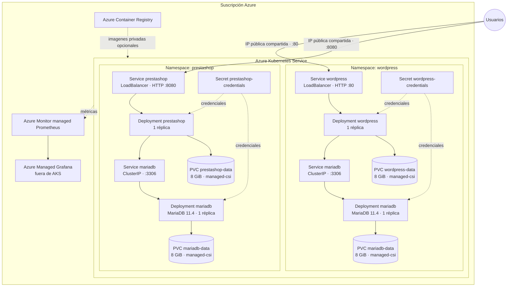

# Arquitectura — Laboratorio 6

## Flujos y aislamiento

- Los usuarios acceden por HTTP a dos Services `LoadBalancer` que comparten la IP pública de WordPress en puertos diferentes: `:80` y `:8080`. La annotation `azure-pip-name` referencia el recurso existente de Azure, evitando crear otra IP pública; cada Service selecciona solo los pods de su namespace.
- Cada aplicación resuelve el host `mariadb` local a su propio namespace. Ambos namespaces pueden tener un Service llamado `mariadb` sin colisión: `wordpress/mariadb` y `prestashop/mariadb` son destinos distintos.
- Las dos DB son ClusterIP; no hay ruta entrante desde Internet. No se comparte PVC, usuario de DB, contraseña ni base entre los portales.
- Cada aplicación monta su PVC en `/var/www/html`; MariaDB monta su volumen independiente en `/var/lib/mysql`. `managed-csi` crea discos administrados de Azure mediante PVC `ReadWriteOnce`.
- Grafana es Azure Managed Grafana y está fuera de AKS. El workspace de Azure Monitor managed Prometheus recolecta métricas de AKS; Grafana consulta ese datasource administrado.
- ACR lo provisiona el template. Los workloads usan imágenes públicas versionadas de Docker Hub en este laboratorio, por lo que no requieren construir una imagen propia ni publicar secretos/imágenes.

## Disponibilidad y límites

Una réplica por portal y por base es apropiada para la práctica, pero no proporciona alta disponibilidad. MariaDB usa estrategia `Recreate` porque cada instancia monta un disco `ReadWriteOnce`; no escales sus réplicas sin migrar a StatefulSet y diseñar replicación/backup. La supervivencia a reinicios de pods está cubierta por PVC, no por backup ante borrado accidental o `azd down`.

Los Load Balancers exponen HTTP públicamente según la rúbrica. Para producción, delante de las apps se recomienda Ingress/Application Gateway con TLS, DNS, WAF y límites de origen; las bases deben seguir privadas. Las StorageClasses de AKS y las políticas de RBAC del clúster son dependencias de la suscripción y versión de AKS.
